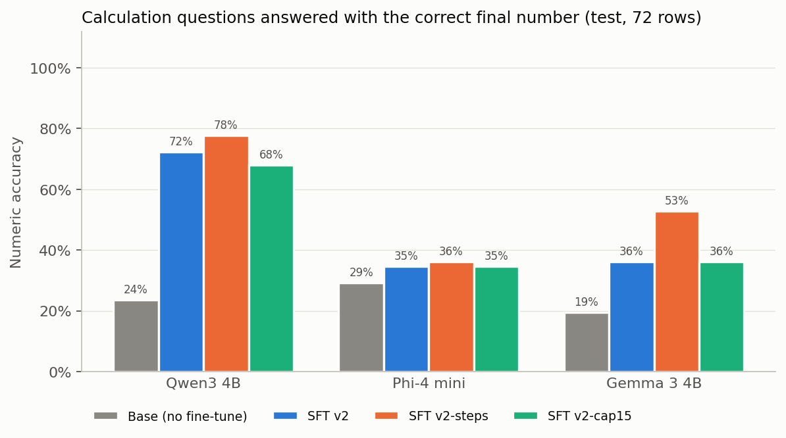
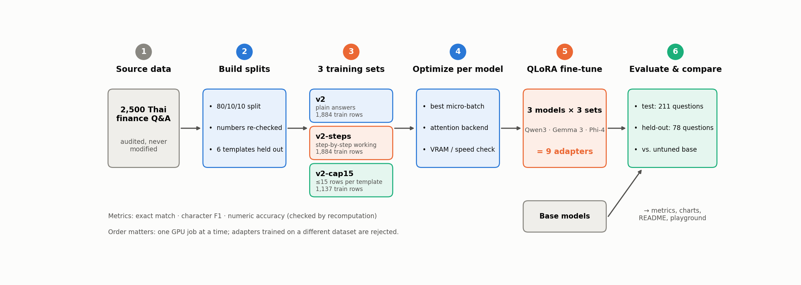
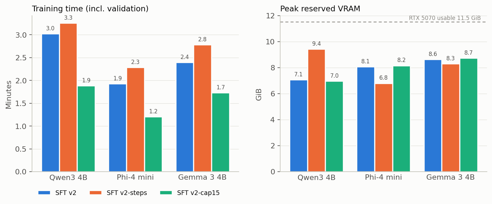
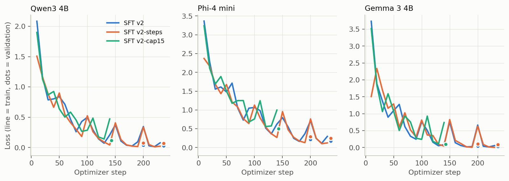
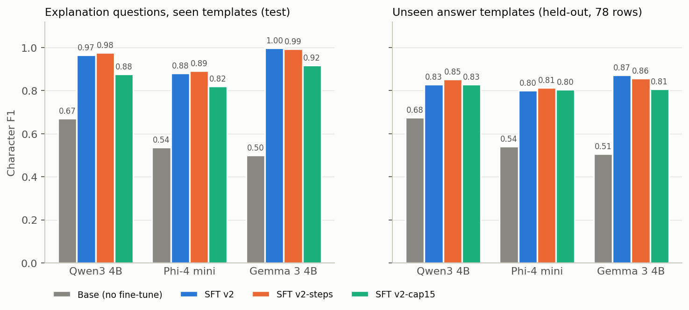
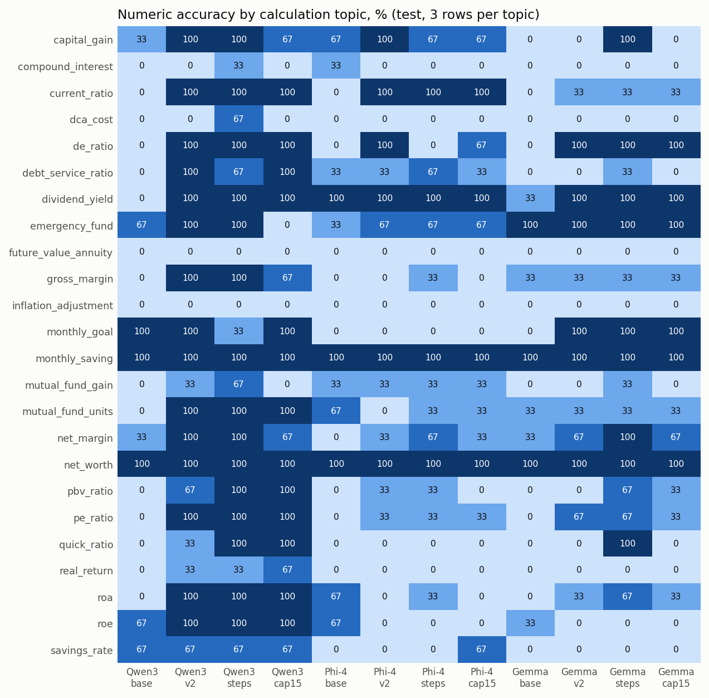
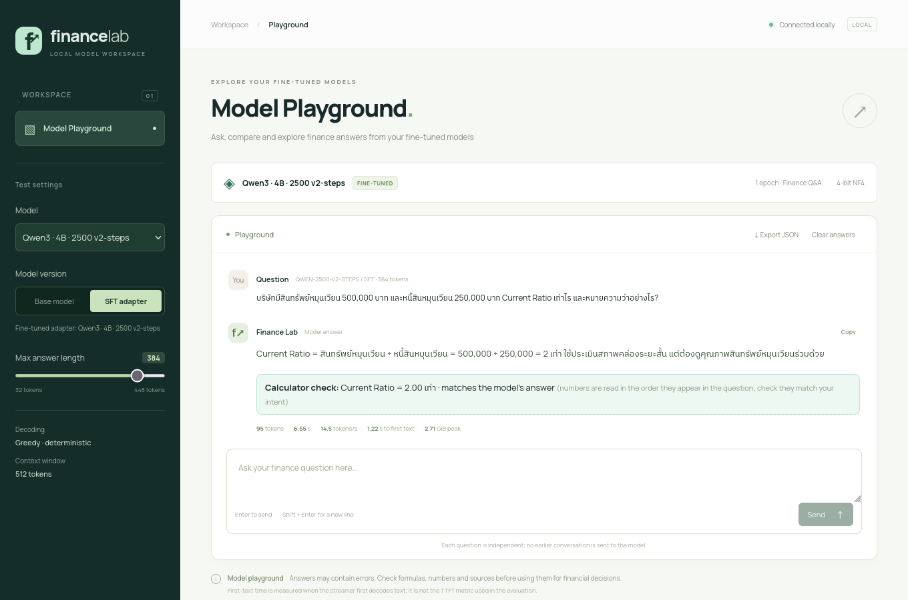

# Finance Q&A — QLoRA fine-tuning (Qwen3 / Phi-4 mini / Gemma 3)

Fine-tune ~4B-parameter models to answer Thai finance questions with **Unsloth + TRL SFT + QLoRA**
(NF4 + double quantization, BF16 compute, LoRA r=16 / alpha=32) on a single **RTX 5070 12 GB**
(Ubuntu 26.04, Python 3.12.10, torch 2.11.0+cu128).

This round trains **3 models × 3 data-preparation variants = 9 adapters** on `finance_best_available_2500`,
then evaluates every adapter against the untuned base model on two test sets.
Everything can be reproduced with one script (see [Reproduce](#reproduce)).

> The data is template-generated and the test sets are small (see [Limitations](#limitations)).
> Nothing has been reviewed by a domain expert. **Do not use these models for real financial decisions.**

## Summary of results



| Finding | Evidence |
|---|---|
| Fine-tuning makes answers complete and well-formed for all 3 models | The base models hit the 256-token ceiling on 152–196 of 211 test answers; after fine-tuning only 0–6 do. Character F1 goes from 0.50–0.60 to 0.79–0.99 |
| **Qwen3 4B + v2-steps** gets the most numbers right | **77.8%** numeric accuracy (base: 23.6%) |
| Step-by-step working (`v2-steps`) helps multi-step calculations | Qwen 72.2→77.8%, Gemma 36.1→52.8%, Phi 34.7→36.1% (almost unchanged) |
| **Gemma 3 4B + v2** reproduces the answer format best but cannot calculate | 72.5% exact match and 0.998 F1 on general text, yet only 36.1% numeric accuracy |
| Using 40% less data (`v2-cap15`) costs only part of the quality | Qwen numeric 72.2→68.1%, same held-out F1, but exact match falls sharply (62.6→7.6%) |
| No model can do exponentiation | `future_value_annuity` and `inflation_adjustment` are **0%** for all 9 adapters; `compound_interest` reaches 33% at best |

The wrong numbers are not a formatting problem: Gemma writes the formula and substitutes the values correctly in
every case, but the final figure drifts slightly, for example `68,790 ÷ 354,070 × 100 ≈ 19.33%` (the correct value is 19.43%).
Calculations should therefore be cross-checked by a calculator, which the playground already does
([finance_qlora/calculator.py](finance_qlora/calculator.py)).

## Pipeline



1. **Source data**: `Dataset/finance_best_available_2500.jsonl`, audited and never modified.
2. **Build splits**: [scripts/build_5000_v2.py](scripts/build_5000_v2.py) makes a stratified split, adds numeric annotations and holds out 6 answer templates.
3. **Three training sets**: `v2` (plain answers), `v2-steps` (step-by-step working), `v2-cap15` (at most 15 rows per template).
4. **Optimize each model before training** ([speed benchmark](#speed-benchmark)): 40-step runs at several micro-batch sizes with effective batch fixed at 8, picking the fastest that fits in 12 GB of VRAM (Qwen 4, Phi 8, Gemma 8; `v2-steps` for Phi/Gemma uses 4 because its answers are longer). The attention backend is chosen per model (Gemma 3 runs eager attention; forced Flex was about 4× slower). Validation loss stays within noise, so these settings change speed, not quality. Results are stored in [configs/models.json](configs/models.json).
5. **QLoRA fine-tune** (NF4, BF16): 3 models × 3 sets = 9 adapters.
6. **Evaluate and compare**: test (211) and held-out (78) against the untuned base models, then charts and this README.

The figure is drawn by [scripts/plot_pipeline.py](scripts/plot_pipeline.py).

## Data

The source `Dataset/finance_best_available_2500.jsonl` (2,500 rows) passed the audit: no schema errors and no duplicate
questions or answers. The file is never modified. The data is template-generated: 770 rows are calculation questions across
24 topics, the rest are scenario questions, and with the numbers masked out the 2,500 answers collapse to only 148 distinct forms.

A plain `prepare` is a poor fit for data like this (no numeric annotations, no stratification, templates repeat across splits),
so [scripts/build_5000_v2.py](scripts/build_5000_v2.py) does the following:

- Splits 80/10/10, **stratified** by calculation topic (24) or by answer template, and groups related rows so they never cross a split
- Gives calculation rows a numeric annotation in validation/test **only when an independent recomputation in code matches the reference** (rows that do not match get none)
- Forces any row that is in the train split of the 1250 set into train, so validation/test contain none of its training rows
- Holds back 6 non-calculation answer templates entirely as a **held-out test** (answers in a form never seen in training)
- Every set passes the checksum and leakage checks of `load_prepared`

| Set (`data/processed/…`) | train | validation | test | How it differs |
|---|---:|---:|---:|---|
| `finance-2500-v2` | 1,884 | 213 | 211 | The main set (the 72 calculation rows in test carry annotations) |
| `finance-2500-v2-steps` | 1,884 | 213 | 211 | The 443 calculation answers in train carry "คำนวณทีละขั้น … สรุป: <original answer>" (step-by-step working, intermediate values computed in code) |
| `finance-2500-v2-cap15` | 1,137 | 213 | 211 | Train keeps at most 15 rows per template |
| `…-heldout` (3 variants) | as each variant's train | 213 | **78** | Test = answer templates absent from train, validation and test |

The test files of the three variants are byte-identical (and so are the held-out ones), so they can be compared directly.

## Training

Every run: 1 epoch, LR 1e-4 (linear, 3% warmup), AdamW 8-bit, max length 512 tokens, effective batch 8, LoRA on the language layers only,
prompt tokens masked so the loss covers only the answer. The micro-batch comes from a benchmark on this machine
([table below](#speed-benchmark)); `v2-steps` for Phi/Gemma uses 4 because its answers are longer.



| Model | Variant | batch × accum | steps | Train time | Validation loss | Peak VRAM |
|---|---|---|---:|---:|---:|---:|
| Qwen3 4B | v2 | 4×2 | 236 | 3.0 min | 0.0310 | 7.1 GiB |
| Qwen3 4B | v2-steps | 4×2 | 236 | 3.3 min | 0.0689 | 9.4 GiB |
| Qwen3 4B | v2-cap15 | 4×2 | 143 | 1.9 min | 0.1189 | 7.0 GiB |
| Phi-4 mini | v2 | 8×1 | 236 | 1.9 min | 0.1764 | 8.1 GiB |
| Phi-4 mini | v2-steps | 4×2 | 236 | 2.3 min | 0.2489 | 6.8 GiB |
| Phi-4 mini | v2-cap15 | 8×1 | 143 | 1.2 min | 0.5001 | 8.2 GiB |
| Gemma 3 4B | v2 | 8×1 | 236 | 2.4 min | 0.0319 | 8.6 GiB |
| Gemma 3 4B | v2-steps | 4×2 | 236 | 2.8 min | 0.0917 | 8.3 GiB |
| Gemma 3 4B | v2-cap15 | 8×1 | 143 | 1.7 min | 0.1024 | 8.7 GiB |

All nine runs took about 23 minutes in total (including model loading and validation). Validation loss is comparable only within one model
(the tokenizers differ), and not directly across variants, because `v2-steps` is validated on answers without step-by-step working.



Lines are the train loss every 10 steps; dots are the validation loss.

## Evaluation results

Greedy decoding, at most 256 generated tokens, 1 warmup batch, the same model revision everywhere.
The `compare` report of each adapter against the base model is in `reports/<model>-2500-<variant>-<set>-comparison.json`.

### Test (211 rows: templates seen in training, new numbers)

| Model | Variant | Exact match | Char F1 | **Numeric** (72 rows) | General-text F1 (139 rows) | Cut at 256 tok |
|---|---|---:|---:|---:|---:|---:|
| Qwen3 4B | Base | 0.0% | 0.602 | 23.6% | 0.670 | 196/211 |
| Qwen3 4B | v2 | 62.6% | 0.962 | 72.2% | 0.966 | 0 |
| Qwen3 4B | **v2-steps** | 59.7% | 0.901 | **77.8%** | 0.977 | 6 |
| Qwen3 4B | v2-cap15 | 7.6% | 0.865 | 68.1% | 0.876 | 0 |
| Phi-4 mini | Base | 0.0% | 0.525 | 29.2% | 0.538 | 152/211 |
| Phi-4 mini | v2 | 15.2% | 0.865 | 34.7% | 0.881 | 0 |
| Phi-4 mini | v2-steps | 18.0% | 0.821 | 36.1% | 0.893 | 0 |
| Phi-4 mini | v2-cap15 | 0.0% | 0.793 | 34.7% | 0.820 | 4 |
| Gemma 3 4B | Base | 0.0% | 0.515 | 19.4% | 0.500 | 157/211 |
| Gemma 3 4B | v2 | **72.5%** | **0.985** | 36.1% | 0.998 | 1 |
| Gemma 3 4B | v2-steps | 68.7% | 0.925 | 52.8% | 0.995 | 2 |
| Gemma 3 4B | v2-cap15 | 29.9% | 0.908 | 36.1% | 0.917 | 2 |

**Numeric** = a calculation answer whose final number matches the reference within a tolerance fixed before measuring (ATOL 0.011, RTOL 0.1%),
over the 72 rows that carry an annotation verified by recomputation. Exact match compares the whole answer text.



### Held-out (78 rows: answer templates never seen)

| Model | Base | v2 | v2-steps | v2-cap15 |
|---|---:|---:|---:|---:|
| Qwen3 4B | 0.675 | 0.829 | **0.854** | 0.830 |
| Phi-4 mini | 0.540 | 0.802 | **0.815** | 0.805 |
| Gemma 3 4B | 0.507 | **0.872** | 0.857 | 0.807 |

The values are character F1. Exact match is 0% in every run, which is expected: these answers were never in the training set.
These rows have no numeric reference, so there is no numeric accuracy for them; the base model is cut at 256 tokens on all 78 rows.

### By calculation topic



- **Wrong for every model:** `future_value_annuity` and `inflation_adjustment` (0%) and `compound_interest` (33% at best), which all need (1+r)^n
- **Right for every model:** `net_worth` and `monthly_saving` (simple subtraction), but Phi and Gemma still miss many single-division topics (for example `roe`, `savings_rate`)
- Each topic has only **3 rows**, so one row is 33 points; read this as a trend only

## Limitations

- **Small test sets:** 72 numeric rows (3 per topic) and 78 held-out rows; differences of a few points (for example Phi v2 vs v2-steps) can be noise
- **One run per setting** (seed 42), no confidence intervals
- **The base model is cut at 256 tokens:** its numeric scores therefore understate its real ability (they measure "complete and correct within the budget", not pure calculation skill),
  and `v2-steps` has 6 answers cut (Qwen). A larger budget (for example 384 tokens) would probably score higher; this was not tried
- **Template-generated data:** the validation/test rows that are not held-out share their templates with train, so high scores do not mean the model copes with real questions;
  neither standard benchmarks nor real user questions have been measured
- **Character F1 and exact match only measure text similarity;** they do not confirm financial correctness, and no human review has been done
- Results from the earlier Windows round (1,250-row split / dev-v3) cannot be compared with this round: different data and test sets.
  The earlier `reports/` files from that round were deleted.

## Speed benchmark

Measured on this machine, 40 steps per setting, effective batch 8, gradient checkpointing off (warmup included); only the micro-batch changes:

| Model | micro-batch | s/step | answer tokens/s | Reserved VRAM | Validation loss |
|---|---|---:|---:|---:|---:|
| Qwen | 1 (old) | 1.66 | 637 | 4.1 GiB | 0.7195 |
| Qwen | 2 | 1.32 | 802 | 5.0 GiB | 0.7194 |
| **Qwen** | **4** | **1.07** | **984** | 7.0 GiB | 0.7199 |
| Phi | 1 (old) | 1.35 | 557 | 3.9 GiB | 1.5247 |
| Phi | 4 | 0.86 | 871 | 5.6 GiB | 1.5197 |
| **Phi** | **8** | **0.83** | **903** | 8.1 GiB | 1.5205 |
| Gemma | 2 | 1.61 | 402 | 5.0 GiB | 1.0608 |
| Gemma | 4 | 1.26 | 512 | 6.0 GiB | 1.0610 |
| **Gemma** | **8** | **1.13** | **569** | 8.5 GiB | 1.0604 |

The chosen values live in [configs/models.json](configs/models.json) (`train_batch_size`); the losses differ only within noise.
- Gemma 3 runs on **eager attention** on the RTX 5070: Unsloth disables SDPA for Gemma 3 and disables Flex because sm120 lacks the shared memory.
  Forcing Flex (`FINANCE_QLORA_ATTN_IMPL=flex_attention`) works but was about 4× slower in a short run because a kernel is recompiled for every new batch length
- Padding efficiency is 0.96–0.98 (length grouping already applied), so padding-free / packing was not pursued

## Reproduce

Needs Python 3.12.10, an NVIDIA GPU with BF16 support and `gcc` (Triton compiles kernels).

```bash
# 1) Create the environment (uv) and install the pinned dependencies
uv venv --python 3.12.10 .venv
uv pip install --python .venv/bin/python --index-strategy unsafe-best-match -r requirements-training-linux.txt
uv pip install --python .venv/bin/python "matplotlib==3.10.7"      # charts only
.venv/bin/python -m finance_qlora doctor --training

# 2) Pre-download the models (much faster than downloading during training).
#    Gemma needs `hf auth login` and accepting its licence on the website first.
HF_XET_HIGH_PERFORMANCE=1 .venv/bin/hf download Qwen/Qwen3-4B-Instruct-2507 --revision cdbee75f17c01a7cc42f958dc650907174af0554
#    (revisions for phi/gemma are in configs/models.json)

# 3) Prepare the data (nothing is overwritten; use fresh output directories)
.venv/bin/python -m finance_qlora audit Dataset/finance_best_available_2500.jsonl --output reports/audit-2500.json
.venv/bin/python scripts/build_5000_v2.py --input Dataset/finance_best_available_2500.jsonl \
    --output data/processed/finance-2500-v2 --heldout-rows-per-template 20 --cap 15
.venv/bin/python scripts/build_scale_steps_dataset.py --source data/processed/finance-2500-v2 --output data/processed/finance-2500-v2-steps
for v in steps cap15; do
  .venv/bin/python scripts/make_heldout_variant.py data/processed/finance-2500-v2-$v data/processed/finance-2500-v2-heldout
done

# 4) Train 9 runs -> evaluate 24 jobs -> compare (skips existing results; about an hour and a half in total)
scripts/run_2500_v2.sh

# 5) Charts and summary
.venv/bin/python scripts/plot_2500_results.py      # -> docs/images/*.png, docs/results-2500-v2.json
```

Run one model with `MODELS=qwen scripts/run_2500_v2.sh`, or call the CLI directly:

```bash
.venv/bin/python -m finance_qlora train --model qwen --data data/processed/finance-2500-v2 --run-dir outputs/qwen-2500-v2
.venv/bin/python -m finance_qlora evaluate --model qwen --data data/processed/finance-2500-v2 --split test \
    --adapter outputs/qwen-2500-v2/adapter --max-new-tokens 256 --batch-size 8 --output outputs/eval-qwen-2500-v2-test
```

Only one GPU job at a time (do not run train / evaluate concurrently). Disk: each run keeps just `adapter/` (108–159 MB); the script deletes `checkpoints/`.

## Project layout

| Path | Role |
|---|---|
| `finance_qlora/` | CLI (`audit`, `prepare`, `doctor`, `tokens`, `train`, `evaluate`, `compare`, `review-*`), the calculator cross-check and the playground API |
| `configs/models.json`, `configs/training.json` | Pinned revision of each model, chosen micro-batch, hyperparameters |
| `scripts/build_5000_v2.py` | Builds the v2 / held-out / cap sets from the source file |
| `scripts/build_scale_steps_dataset.py`, `make_heldout_variant.py` | The steps set, and the held-out set for each variant |
| `scripts/run_2500_v2.sh`, `plot_2500_results.py` | The train + evaluate pipeline and the charts |
| `scripts/bench_batch_linux.sh`, `summarize_bench.py` | Micro-batch benchmark |
| `outputs/<model>-2500-<variant>/` | `adapter/`, `run.json` (config, metrics, loss history, VRAM), `requirements-resolved.txt` |
| `outputs/eval-*/` | `metrics.json` and `predictions.jsonl` of each evaluation |
| `docs/` | `metrics.md` (metric definitions), `playground.md`, `images/`, `results-2500-v2.json` |
| `web/` | Next.js page for trying the models |
| `AI_HANDOFF.md` | Hand-over notes for the next person / agent working in this repository |

## Web playground

A Next.js + Python API page (loopback only, no authentication) for trying all 9 adapters and switching to the untuned model.
Details are in [docs/playground.md](docs/playground.md).



The page has a left panel for the test settings (model, base model vs. SFT adapter, max answer length, a read-out of decoding and context window, and a button to release GPU memory)
and a main area with example questions, a question box (Enter sends, Shift+Enter adds a line) and the streamed answers, which render Markdown and LaTeX and can be exported as JSON.
The screenshot is a real session: Qwen3 4B with the `v2-steps` adapter answering the Current Ratio question (500,000 ÷ 250,000 = 2) in 95 tokens, 6.6 s on the RTX 5070.
Under the answer the calculator cross-check confirms the figure, and the line below shows tokens, time, speed, time to first text and CUDA peak (2.7 GiB).

On Linux, start it in two terminals:

```bash
# Terminal 1 — Python API (loads the model onto the GPU on the first question; do not run during train/evaluate)
HF_HUB_OFFLINE=1 .venv/bin/python -m finance_qlora.playground --port 8000

# Terminal 2 — Next.js (needs Node.js >= 20.9; if node_modules came from Windows, delete it and reinstall)
cd web && rm -rf node_modules && npm ci && npm run dev      # opens http://127.0.0.1:3000
```

- The model list is `catalog()` in [playground.py](finance_qlora/playground.py); it reads only runs that are `complete` and have a real adapter
- Maximum answer length: SFT adapters use a 512-token context (as trained) and the untuned model uses 1,024 because it answers much longer.
  The default is 384 (the longest `v2-steps` training answers are 261–334 tokens). If a question is long, the answer budget is shrunk to fit the context
  and a notice appears when an answer reaches the ceiling; a question is rejected only when fewer than 32 tokens remain for the answer
- One GPU job at a time: the page waits while a train/evaluate job that logs progress is running
- `scripts/start_playground.ps1` is the older Windows launcher

## License

The code is released under the [MIT License](LICENSE). The base models and the dataset keep their own licenses and terms (Gemma 3 is gated and has its own terms of use).

## References

- [Unsloth Blackwell / RTX 50](https://unsloth.ai/docs/blog/fine-tuning-llms-with-blackwell-rtx-50-series-and-unsloth)
- [TRL SFT Trainer](https://huggingface.co/docs/trl/sft_trainer)
- [Bitsandbytes NF4 and double quantization](https://huggingface.co/docs/transformers/quantization/bitsandbytes)
